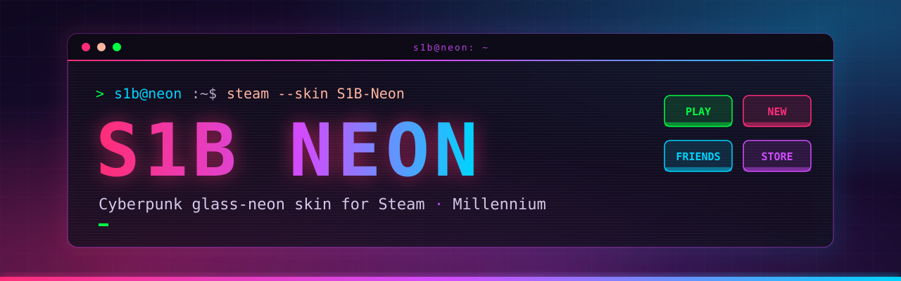
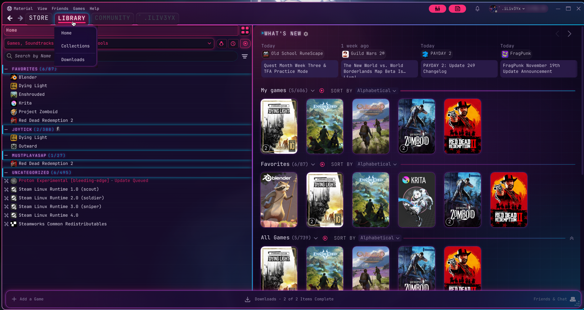
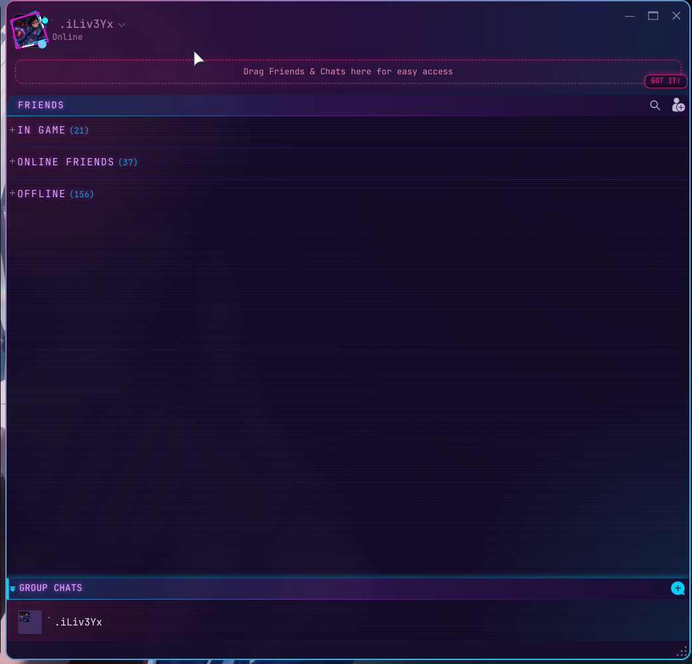
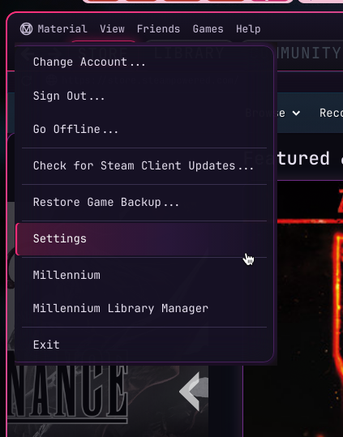
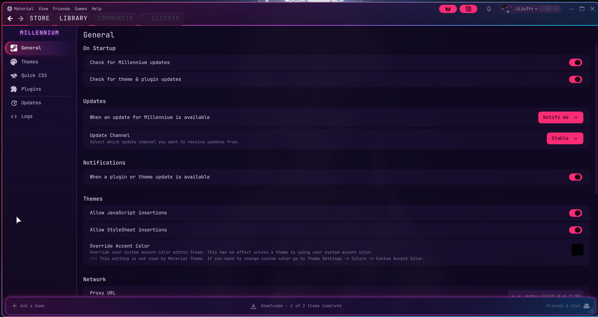
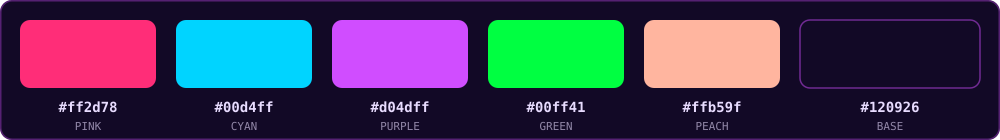

<div align="center">



<br>


**Deep violet glass, neon glows, keycap buttons and terminal-style headers.**<br>
A lit city at night that is still easy to read.

</div>

---

## Screenshots

<table>
  <tr>
    <td colspan="2"><br><sub><b>Library</b></sub></td>
  </tr>
  <tr>
    <td width="50%"><br><sub><b>Friends and chat</b></sub></td>
    <td width="50%"><br><sub><b>Menu</b></sub></td>
  </tr>
  <tr>
    <td colspan="2"><br><sub><b>Settings</b></sub></td>
  </tr>
</table>

## Palette

<div align="center">
  
</div>

| Role   | Hex       |
|--------|-----------|
| Pink   | `#ff2d78` |
| Cyan   | `#00d4ff` |
| Purple | `#d04dff` |
| Green  | `#00ff41` |
| Peach  | `#ffb59f` |
| Base   | `#120926` |

## Features

- **Glass panels** on a deep violet base (`#0f0820` to `#1a0d36`), with soft radial glows and subtle scanlines
- **Keycap buttons and chips** with depth and press states. PLAY is a neon green keycap
- **Terminal headers**: uppercase, neon text-shadow and a blinking `>` prompt
- **Library**: neon gradient line on the top bar, sidebar edge, collection headers with a glowing cyan bar, capsule hover lift with a cyan and pink ring
- **Store**: framed main carousel, Personal Calendar cards (past in dim cyan, TODAY in pink glow with a keycap label, future in purple), glass specials panel, pink NEW chip, neon green discount keycaps, glowing carousel dots
- **Friends and chat**: violet glass list, FRIENDS / GROUP CHATS headers, in-game friends in `#00ff41`, online in cyan, offline dimmed, avatar rings, keycap send button
- **Game page, downloads, settings, tooltips and toasts** restyled to match
- **Lightweight**: no animated blur on large areas

## Requirements

- Steam desktop client with [Millennium](https://steambrew.app)
- [JetBrainsMono Nerd Font](https://www.nerdfonts.com/font-downloads) installed system-wide (see [Font](#font))

## Install

S1B Neon is a regular Millennium theme: a folder with a `skin.json` inside Millennium's themes directory.

1. Clone or download this repository into your Steam themes folder, in a folder called `S1B-Neon`:

   ```sh
   # Linux
   cd ~/.steam/steam/steamui/skins
   git clone https://github.com/ind4skylivey/s1b-neon-steam.git S1B-Neon
   ```

   | OS      | Themes folder |
   |---------|---------------|
   | Linux   | `~/.steam/steam/steamui/skins` |
   | Windows | `<Steam>\millennium\themes` (older Millennium versions: `<Steam>\steamui\skins`) |

   `<Steam>` is your Steam install path, usually `C:\Program Files (x86)\Steam`.

2. Open Steam, go to **Settings → Themes** (the Millennium page) and pick **S1B Neon** under **Client Theme**.
3. Restart Steam when Millennium asks you to.

S1B Neon is self-contained. You do not need Material-Theme installed.

The theme folders Millennium uses can differ by distro or Millennium version. If yours is not listed above, check the [Millennium file system reference](https://docs.steambrew.app/users/getting-started/structure).

## Configuration

Open **Settings → Themes** and use the **S1B Neon** options. The defaults in `skin.json` are:

| Option | Default |
|---|---|
| S1B Neon Layer | on |
| Appearance | Dark |
| Color | Custom (accent `#ff2d78`, Vibrant generation style) |
| Font | JetBrainsMono Nerd Font |
| Blur | Enabled |
| Game Card Hover Animation | Move Up |
| Game Icons Shape / Groups Picture Shape | Rounded Square |
| Online Indicator | Alternative |
| Store Header Always Visible | yes |
| Remove Shiny Effect | yes |
| Hide Big Picture Mode Button | yes |
| Hide Add Shelf / Hide Activity Posting | yes |
| Swap Dialog Buttons | yes |
| Account name and balance | Blur (show on hover) |

To get plain Material back, set **S1B Neon Layer** to `off`.

### Customize

- `mods.css` is for your own overrides. Turn on **Extra → Use Modifications File** to load it.
- `customFont.css` is loaded when **Font** is set to **Custom**.
- The neon layer lives in `css/s1b/neon.css`. The palette variables are at the top (`--neon-*`).

## Font

The theme is designed around **JetBrainsMono Nerd Font**. Install it system-wide from [Nerd Fonts](https://www.nerdfonts.com/font-downloads) and restart Steam. If it is missing, the theme falls back to JetBrains Mono and then to your system monospace font.

## Notes

Steam uses hashed class names, and a client update can rename some of them. If a section loses its styling after an update, those selectors need refreshing. Please [open an issue](../../issues).

## Credits

- Base theme: [Material-Theme](https://github.com/kuska1/Material-Theme) by **kuska1** (Bogdan Kus'), MIT License
- S1B Neon layer, palette and defaults: **ind4skylivey**
- Built for [Millennium](https://steambrew.app)

## License

Released under the [MIT License](LICENSE). The original Material-Theme copyright notice is kept, as the license requires.
